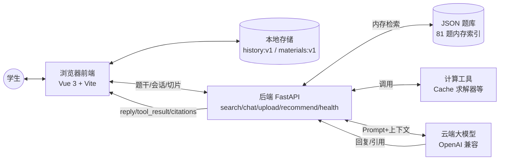
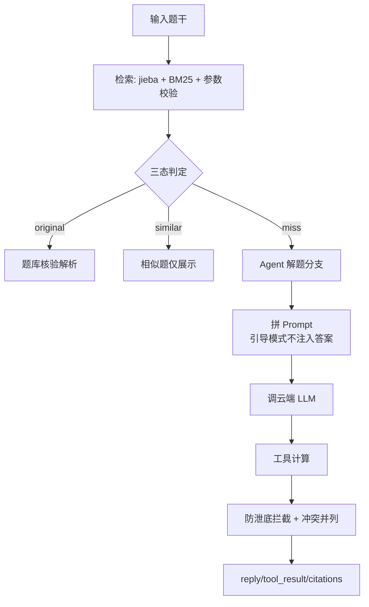
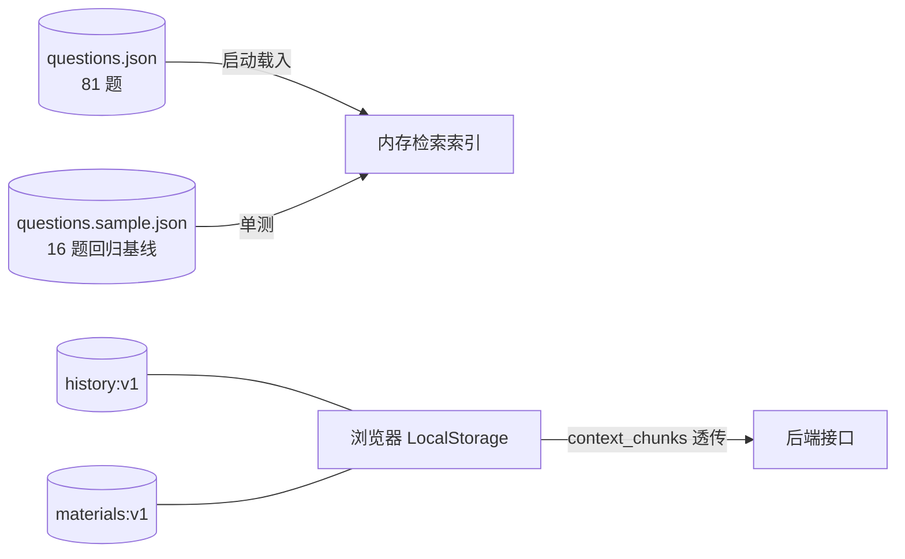

# 系统架构图（Alpha · 对应实际版本）

> 维护：叶凯乐（TL）｜ 更新：2026-11-13 ｜ 对应主干 81 题 v1.1、5 接口

## 一、系统交互架构

## 二、Agent 链路

## 三、数据存储

## 四、核心设计原则

1. 后端无状态：不保存用户数据，历史/资料在浏览器本地，随请求透传。
2. 题库只读：JSON 文件启动载入内存，检索用内存索引。
3. 无状态切片：个人资料切片随 `context_chunks` 发送，后端不落库。
