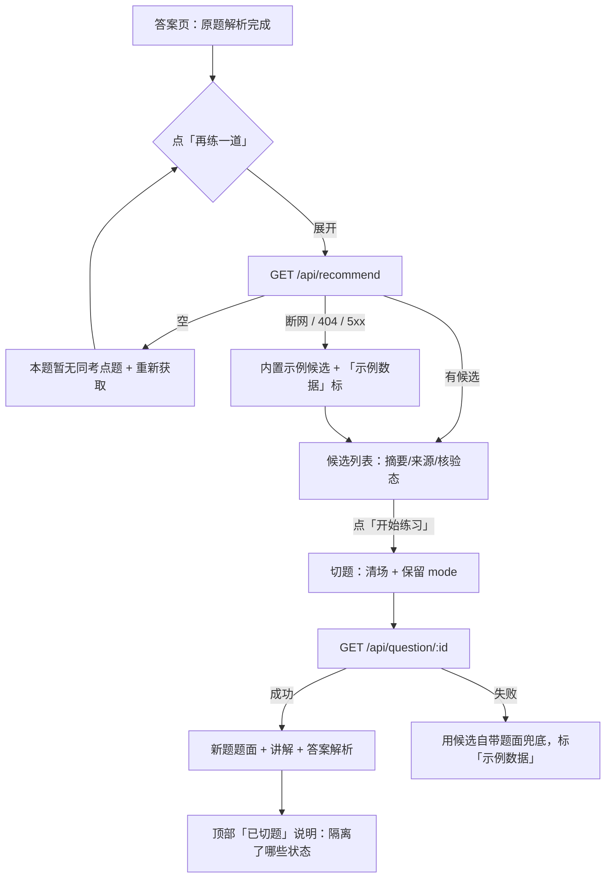

# 同考点推荐与新题学习 · 前端交付说明

> 模块：答案页「再练一道同考点题」入口 + 切题（新题学习）
> 归属：王翔鹏（答案页 / 步骤页 / 教学模式页）
> 分支基线：`main`（PR #8 已合并后的主干）
> 更新时间：2026-11-06　｜　状态：**代码与自检完成，待提 PR**

---

## 1. 本次交付做了什么

在答案页原有解析流之后加了一条"继续练"的支路，包含四件事：

| 需求原文 | 实现 |
| :--- | :--- |
| 在答疑页增加「再练一道同考点题」入口 | 答案页解析完成后出现入口卡，默认收起，点击才拉推荐（不增加首屏请求） |
| 展示题目摘要、来源和核验状态 | 每条候选一行：题干摘要（2 行截断）、`来源 · 题库编号`、`已核验 / 待审核 / 待核验` 彩色标签，另附考点与难度 |
| 切题时保留教学模式，隔离旧题上下文、作答、答案揭示状态及工具结果 | `useAnswerFlow.startPractice()` 统一清场：请求序号作废、切片/消息/工具结果/引用/揭示态/错误归零、作答置空、`mode` 原样带回；切题后页面顶部列出"到底隔离了什么" |
| 无候选时明确提示 | 面板空态："本题暂无同考点题" + 具体原因 + `重新获取`；未命中原题时入口直接置灰并说明"无法定位考点" |

对应截图见 `docs/screenshots/`：`practice-panel.png`、`practice-empty.png`、`practice-after-switch.png`。

---

## 2. 交互流程



页面状态机（推荐面板）：`idle → loading → ready | empty | error`，四态各有独立 UI，不共用分支。

---

## 3. 状态隔离机制

"切题"不是重新检索，而是把同一份 `session` 换成新题。落地时按五步走：

| 步骤 | 做什么 | 代码位置 |
| :--- | :--- | :--- |
| 1 | `sequence++` 作废旧请求，旧题迟到的 `/chat` 响应直接丢弃 | `useAnswerFlow.startPractice` |
| 2 | `session.reset()` 清空结果、消息、切片、`lastReply`、`answerRevealed`、`chatError`、`restoredFromHistory` | `store/session.js` |
| 3 | `myThought = ''`：新题不带旧作答 | `startPractice` |
| 4 | `mode` 取切换前的值：引导仍是引导，直接讲解仍是直接讲解 | `startPractice` 里 `const mode = session.mode` |
| 5 | 揭示态归零后由 `answerCollapsed` 计算属性自动归位（引导收起 / 直接展开） | `store/session.js` + `AnswerView` 的 `answerExpanded` 同步 |

被隔离的状态清单（也是「已切题」卡片上展示的内容）：

| 状态项 | 旧题 | 切题后 |
| :--- | :--- | :--- |
| 题目上下文 `context_chunks` | N 段切片 | 清空，按新题干重新打分选片 |
| 我的作答 `myThought` | 用户原话 | 置空，新题从空白思路开始 |
| 追问记录 `messages` | N 条 | 清空，`session_messages` 只发新题内容 |
| 答案揭示状态 `answerRevealed` | 展开/收起 | 归零，按当前模式重置 |
| 工具结果 `lastReply.toolResult` | 有 | 不继承，需对新题重新计算 |
| 引用出处 `citations` | N 条 | 不继承，重新取 |
| 冲突项 `conflictClaims` | 有 | 由 `lastReply` 计算，随之为空 |

另外三处配套改动，避免"看着隔离了、其实还在漏"：

- **路由带 `practice=<id>`**：切题后 URL 变成 `#/answer?q=<新题干>&mode=...&practice=Q-CACHE-033`，刷新直接回到练习态（`findCandidate(id)` 还原），不会退回原题。
- **路由 watcher 加守卫**：原页面监听 `q/mode` 变化会重新检索；练习态下这些变化由切题自己造成，必须跳过，否则刚换的新题会被原题检索覆盖。
- **切题失败可重试**：`practice.pending` 记住目标题，错误页的"重试"重试切题本身，不会退回关键词检索。

---

## 4. 数据契约（建议稿，待 TL 确认）

> 现状：`/api/recommend` 与 `/api/question/{id}` **尚未实现**。开发代理指向 `127.0.0.1:8000`，后端未起或未实现时会返回 404/5xx。
> 前端按"真请求 + 兜底"处理：请求照发，断网 / 404 / 5xx 才回落到内置示例候选，并在 UI 标「示例数据」；其余错误照常抛出，让用户看到并可重试。

### 4.1 推荐候选

```
GET /api/recommend?question_id=Q-CACHE-001&limit=3
```

```json
{
  "code": 0,
  "data": {
    "knowledge_point": "组相联映射与地址划分",
    "candidates": [
      {
        "question_id": "Q-CACHE-033",
        "stem": "某计算机按字节编址，主存地址 32 位……",
        "source_ref": "题库 Q-CACHE-033 · 计算机组成原理",
        "review_state": "verified",
        "knowledge_points": ["组相联映射", "地址字段划分"],
        "difficulty": 3,
        "reason": "同为四路组相联，只是容量与块大小不同"
      }
    ]
  }
}
```

| 字段 | 必填 | 说明 |
| :--- | :-: | :--- |
| `candidates` | ✓ | 也兼容 `recommendations` / `similar_questions` / `items` 三种键名 |
| `question_id` |  | 缺失时按题干去重，仍可展示，但无法用路由还原 |
| `stem` | ✓ | 空题干的元素会被丢弃 |
| `source_ref` |  | 缺失时展示"题库未标注来源"，不编造 |
| `review_state` |  | `verified / pending / unverified`，也认中文"已核验/待审核/待核验"，未知值按待核验 |
| `knowledge_points` |  | 最多展示 2 个 |
| `difficulty` |  | 1–5，缺失则不显示 |

### 4.2 新题详情

```
GET /api/question/{question_id}
```

返回结构与 `/api/search` 的 `question_data` 一致。建议后续补三个字段，前端已支持（缺了自动退回模型讲解解析）：

| 字段 | 说明 |
| :--- | :--- |
| `steps[]` | `{ title, formula, detail }`，题库核验解析的分步结构 |
| `hints[]` | 与 `steps` 等长的提示语，用于引导模式 |
| `segments[]` | `{ label, bits, tone }`，地址分段条 |

---

## 5. 本地验收步骤

```bash
cd frontend
npm install
npm run test:practice   # 53 条断言
npm run build
npm run dev             # http://localhost:5173
```

> 路由是 **hash 模式**：`http://localhost:5173/#/answer?...`，注意 `#`。
> 默认 Mock 模式是 `backend`（连真实后端）；验收 UI 请带 `?mock=original` 使用本地演示数据。

| # | 操作 | 期望 |
| :-: | :--- | :--- |
| 1 | 打开 `#/answer?mock=original` | 解析下方出现「再练一道同考点题」，默认收起，无额外请求 |
| 2 | 点「再练一道」 | 出现 3 条候选，每条都有摘要、`来源 · 题库 Q-CACHE-0xx`、核验态标签；已核验排在前 |
| 3 | 点第 1 条的「开始练习」 | 顶部出现「已切题」说明；题面换成 64 KiB / 128 B；「我的思路」为空；答案卡仍收起；模式仍是引导 |
| 4 | 展开参考答案 | 答案是 18 / 7 / 7，四步推导与分段条都是新题的，不是案例题的 19 / 7 / 6 |
| 5 | 点「分步提示」 | 步骤页显示新题步骤，右栏考点为"组相联映射 / 地址字段划分" |
| 6 | 刷新页面 | 仍停留在练习态（URL 带 `practice=Q-CACHE-033`） |
| 7 | `#/answer?mock=original&panel=practice&rec=none` | 空态："本题暂无同考点题" + 原因 + 重新获取 |
| 8 | `#/answer?mock=original&panel=practice&rec=error` | 推荐失败 + 重试，页面其余部分不受影响 |
| 9 | 切到「直接讲解」再切题 | 答案默认展开，说明文案为「教学模式保持『直接讲解』」 |
| 10 | `#/answer?mock=miss` | 入口置灰，写明"未命中原题，无法确定考点" |

演示参数（不影响真实逻辑，只用于验收）：

| 参数 | 作用 |
| :--- | :--- |
| `?panel=practice` | 进页面即展开推荐面板 |
| `?rec=none` | 强制空候选 |
| `?rec=error` | 强制推荐失败 |
| `?rec=slow` | 延迟 3.5s，看骨架屏 |
| `?practice=<question_id>` | 直接进入练习态（刷新还原用） |

---

## 6. 自动化测试

`npm run test:practice`，53 条断言，覆盖：

1. 候选筛选：排除当前题、同 id / 同题干去重、丢弃无题干脏数据、限额；
2. 排序与展示：已核验优先、同态内难度降序、摘要截断、未知核验态兜底；
3. 隔离审计：六项状态计数、空状态不虚报、纯空白作答不算已作答；
4. 契约归一化：三种候选键、字符串元素、缺字段降级、`data` 包裹；
5. 内置 fixture：三种核验态齐全、已核验题必有答案、待核验题无答案；
6. 题面归一化与占位短串：`steps/hints/segments` 降级规则、`velit`/`est` 这类短拉丁占位词判定。

---

## 7. 已知限制

1. **后端未实现推荐接口**：`/api/recommend`、`/api/question/{id}` 目前由前端约定。后端未起或返回 404/5xx 时用内置候选，UI 有「示例数据」标；真实后端上线后 `fromFallback` 会自动变 false，「示例数据」标签随之消失。
2. **候选题编号只在演示数据里存在**：真后端模式下 `/api/chat` 拿到 `Q-CACHE-033` 这类编号可能返回错误；验收请用 `?mock=original`，等题库数据接入后再联调。
3. **候选题的讲解是内置示例文案**：演示模式下 `/chat` 只会讲案例题（32 KiB / 64 B），练习态改用候选题自带的 `guidedReply / directReply`，保证推导与题面一致。
4. **`demo.html` 单文件版未同步**：该文件是离线演示快照，本次只改应用工程。
5. **历史两套存储仍在**：本模块写 `wj:v1:*`；郑志銮的 `store/history.js` 是另一套，练习记录暂不出现在「学习记录」页，合并口径待 TL 定。
6. **视觉体系暂并存**：侧栏深色（`#1b2a41`）+ 内容浅色蓝白（`#2f5ae0`），最终以哪套为准待定。

---

## 8. 文件清单

**新增（9）**

| 文件 | 作用 |
| :--- | :--- |
| `src/components/answer/PracticeRecommend.vue` | 入口卡 + 候选面板（加载/有候选/空/错误） |
| `src/components/answer/PracticeSwitchNotice.vue` | 「已切题」隔离说明 |
| `src/components/answer/PracticeQuestionBrief.vue` | 练习态题面卡（题干/来源/核验态/考点/难度） |
| `src/composables/usePracticeList.js` | 候选列表状态机与取数 |
| `src/store/wjPractice.js` | 切题锁、失败待重试、隔离审计 |
| `src/api/practice.js` | `/api/recommend`、`/api/question/:id` 封装与兜底 |
| `src/mock/fixtures/practiceCandidates.js` | 4 道示例候选（三种核验态，含步骤/提示/分段/讲解） |
| `src/utils/practice.js` | 筛选、排序、摘要、隔离审计等纯函数 |
| `scripts/test-practice.mjs` | 53 条断言 |

**修改（8）**

| 文件 | 改动 |
| :--- | :--- |
| `src/views/AnswerView.vue` | 接入入口/题面卡/切题说明；`practice` 路由参数；切题时跳过检索；练习态换追问建议 |
| `src/views/StepsView.vue` | 步骤解析带上题目自带 steps；练习态考点；跳过重新检索 |
| `src/views/TeachingView.vue` | 练习态考点；不因进教学页而重新检索 |
| `src/composables/useAnswerFlow.js` | 新增 `startPractice()`；`retry()` 优先重试切题 |
| `src/composables/useStepParser.js` | 支持题目自带 `steps / hints / segments`（不引入案例兜底） |
| `src/api/normalize.js` | 新增 `normalizeRecommend()`；`normalizeQuestion()` 补 `steps/hints/segments` |
| `src/mock/garbage.js` | 短拉丁占位词（`velit`/`est`）判定，避免乱码上屏 |
| `src/constants/demo.js` | 新增 `DEMO_KNOWLEDGE_POINT`、`PRACTICE_SUGGESTIONS` |
| `package.json` | 新增 `test:practice` |

---

## 9. PR 说明模板（可直接粘贴）

```markdown
## 这次加了什么
答案页新增「再练一道同考点题」：推荐 → 切题 → 新题学习一条完整支路。

## 关键实现
- 入口默认收起，展开才请求 `/api/recommend`，不给首屏加负担
- 候选展示三要素：题干摘要、来源（题库编号）、核验状态（已核验/待审核/待核验）
- 切题统一走 `useAnswerFlow.startPractice()`：旧请求作废，上下文/作答/追问/工具结果/引用/揭示态全部隔离，`mode` 原样保留
- 切题后页面顶部列出"隔离了什么"，把不可见的清场变成可见的验收点
- URL 带 `practice=<id>`，刷新不退回原题；切题失败可重试切题
- 练习态的题面卡带来源与核验状态；待核验题不展示题库答案，只给模型讲解

## 怎么验
1. `cd frontend && npm install && npm run test:practice && npm run build`
2. `npm run dev` → `#/answer?mock=original`
3. 点「再练一道」→「开始练习」，核对题型切换后的答案、步骤、模式
4. 空态：`#/answer?mock=original&panel=practice&rec=none`
5. 推荐失败：`#/answer?mock=original&panel=practice&rec=error`

详细步骤与状态隔离清单见 `frontend/docs/PRACTICE-RECOMMEND.md`。

## 测试
- `npm run test:practice`：53 条断言，全过
- `npm run build`：通过

## 待确认
- `/api/recommend`、`/api/question/{id}` 尚未实现，当前 404/5xx 回落内置候选并标「示例数据」，需 TL 确认字段口径
- README §2.1 仍写着"同考点推荐列为 P1/P2 本轮暂缓"，需要同步更新
- 练习记录暂只写 `wj:v1:*`，是否并入 `store/history.js` 待定
```

---

## 10. 后续可做

- 接真契约：后端实现 `/api/recommend` 后，`fromFallback` 自然为 false，UI 上的「示例数据」自动消失。
- 推荐排序：目前只按核验态 + 难度，后续可加"用户最近做错的知识点"权重。
- 练习记录：把切题链路写进 `store/history.js` 时补一个 `source: 'practice'` 字段，便于统计"同考点练习了多少道"。
